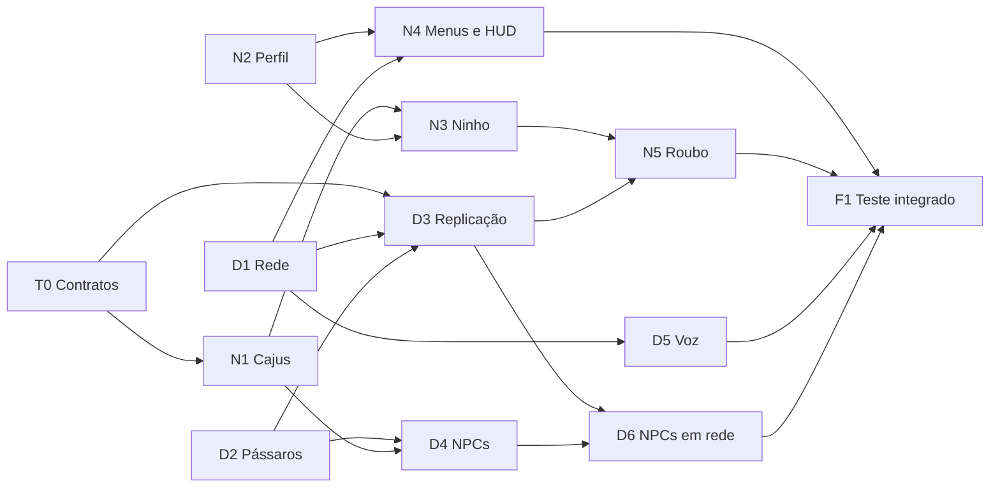

# Birds&Cashews: divisão do trabalho

Plano para **Neto** e **Daniel** desenvolverem em paralelo, cada um no seu computador, usando subagents do Claude Code.
A entrega é em **07/12/2026**. As regras do jogo estão em [`PLANO.md`](PLANO.md).

## Situação atual

Atualizado em 18/11/2026, com a `main` no commit `8976ab6`. Ela compila e passa nas 369 verificações de `./birds --selftest`.

| Tarefa | Dono | Situação | Onde está | O que falta |
|---|---|---|---|---|
| T0 Contratos | Neto | **Concluída** | PR #1 | Nada |
| N1 Cajus e carga | Neto | **Concluída** | PR #3 | Nada |
| N2 Perfil e record | Neto | **Concluída** | PR #2 | Nada |
| N3 Ninho e upgrades | Neto | **Concluída** | PR #4 | Nada |
| N4 Menus, HUD e sons | Neto | **Aguardando validação** | PR #7, aberto | Testar com janela, webcam e som, depois fazer o merge |
| N5 Roubo e colisões | Neto | Não iniciada | Nenhum | Pode começar com o substituto da D3 |
| D1 Rede local | Daniel | **Concluída, com testes pendentes** | PR #6 | Ver `RESULTADOS_TESTE_REDE.md` |
| D2 Pássaros procedurais | Daniel | **Concluída** | PR #5 | Registrar os testes no `--selftest` |
| D3 Replicação de jogadores | Daniel | Não iniciada, **destravada** | Nenhum | Implementar |
| D4 Ecossistema de NPCs | Daniel | **Em andamento** | Branch `daniel/d4-npcs`, sem PR | Resolver conflitos e abrir o PR |
| D5 Voz por proximidade | Daniel | Não iniciada, **destravada** | Nenhum | Implementar |
| D6 NPCs em rede | Daniel | Bloqueada | Nenhum | Depende de D3 e D4 |
| F1 Teste integrado | Ambos | Bloqueada | Nenhum | Depende de N4, N5, D5 e D6 |
| F2 Documentos | Neto | Não iniciada | Nenhum | README, UML, uso de IA e créditos |
| F3 Apresentação | Ambos | Bloqueada | Nenhum | Depende de F1 |

### Próximos passos

**Neto**
1. Testar o PR #7 no jogo real: navegação, calibração com webcam, HUD, menu do ninho e sons.
2. Fazer o merge do PR #7.
3. Iniciar a N5 e a F2 em paralelo, como prevê a Onda 3.

**Daniel**
1. Esperar o merge do PR #7 e só então atualizar a branch `daniel/d4-npcs` com a `main`.
2. Abrir o PR da D4. Hoje a branch conflita com a `main` em 6 arquivos e com o PR #7 em 8 arquivos.
3. Explicar no PR da D4 as mudanças em pastas estáveis: voo, gestos e o arquivo `models/pose_trimmed.onnx`, que foi alterado.
4. Registrar `runNetworkSelfTest` e `runBirdFactorySelfTest` em `runSelfTests`, em `src/main.cpp`.
5. Iniciar a D3 e a D5.

## 1. Resumo

| Pessoa | Frente | Entrega principal |
|---|---|---|
| **Neto** | Jogo | Cajus, ninho, upgrades, perfil, record, menus, HUD e sons |
| **Daniel** | Conexão e vida no mundo | Rede local, pássaros procedurais, NPCs e voz |

O trabalho acontece em ondas. Em cada onda, a pessoa abre o Claude Code e dispara **duas tarefas ao mesmo tempo**, uma por
subagent, em pastas diferentes.

| Onda | Período | Neto | Daniel | Ponto de encontro |
|---|---|---|---|---|
| 0 | 19/11 | **T0** Contratos | Preparar o computador | T0 na `main` |
| 1 | 19 a 23/11 | **N1** Cajus + **N2** Perfil | **D1** Rede + **D2** Pássaros | 23/11: as quatro na `main` |
| 2 | 24 a 28/11 | **N3** Ninho + **N4** Menus e HUD | **D3** Replicação + **D4** NPCs | 28/11: dois jogadores no mesmo mundo |
| 3 | 29/11 a 03/12 | **N5** Roubo + **F2** Documentos | **D5** Voz + **D6** NPCs em rede | 03/12: tudo na `main` |
| 4 | 04 a 06/12 | **F1** Teste integrado + **F3** Apresentação | **F1** Teste integrado + **F3** Apresentação | 06/12: ensaio final |

Daniel não precisa esperar a T0: **D1 e D2 não dependem de nenhuma outra tarefa**.

## 2. O que destrava cada tarefa



| Tarefa | Dono | Depende de | Destrava |
|---|---|---|---|
| T0 Contratos | Neto | Nada | N1, D3 |
| N1 Cajus e carga | Neto | T0 | N3, D4 |
| N2 Perfil e record | Neto | Nada | N3, N4 |
| N3 Ninho e upgrades | Neto | N1, N2 | N5 |
| N4 Menus, HUD e sons | Neto | N2, D1 | F1 |
| N5 Roubo e colisões | Neto | N3, D3 | F1 |
| D1 Rede local | Daniel | Nada | D3, D5, N4 |
| D2 Pássaros procedurais | Daniel | Nada | D3, D4 |
| D3 Replicação de jogadores | Daniel | T0, D1, D2 | N5, D6 |
| D4 Ecossistema de NPCs | Daniel | D2, N1 | D6 |
| D5 Voz por proximidade | Daniel | D1 | F1 |
| D6 NPCs em rede | Daniel | D3, D4 | F1 |
| F1 Teste integrado | Ambos | N4, N5, D5, D6 | Entrega |
| F2 Documentos | Neto | Nada | Entrega |
| F3 Apresentação | Ambos | F1 | Entrega |

**Se uma dependência atrasar, ninguém para.** Use o substituto abaixo e troque pelo real quando a tarefa chegar à `main`.

| Falta | Substituto temporário |
|---|---|
| N1 para a D4 | Lista fixa de posições de cajus no teste |
| D1 para a N4 | Tela de salas com dados falsos, usando a interface `NetSession` |
| D2 para a D3 | Uma esfera colorida no lugar do pássaro remoto |
| D3 para a N5 | `LocalAuthority` com um segundo jogador simulado |

## 3. Preparar o computador

Neto já está com o ambiente pronto. **Daniel** precisa de Ubuntu 22.04 ou mais recente, webcam e acesso de colaborador ao
repositório:

```bash
sudo apt install g++ make pkg-config libopencv-dev libsdl2-dev libopus-dev libglm-dev libgl-dev
git clone https://github.com/fermneto/Birds-Cashews.git
cd Birds-Cashews
make -j8
./birds --selftest      # todos os testes devem passar
./birds --camera-test   # a detecção de pose deve ficar acima de 15 FPS
./birds --teclado       # abre o jogo sem precisar da webcam
```

## 4. Quem pode alterar cada pasta

Essa separação evita conflitos de merge entre os subagents.

| Pasta | Dono |
|---|---|
| `src/game/`, `src/save/`, `src/ui/`, `assets/` | Neto |
| `src/net/`, `src/procedural/`, `src/ai/`, `src/voice/` | Daniel |
| `src/shared/`, `src/core/Game.*`, `src/main.cpp`, `Makefile` | Compartilhado |
| `src/vision/`, `src/entity/`, `src/world/`, `src/gfx/`, `src/input/` | Estável, alterar só com aviso |

Mudanças nas pastas compartilhadas ou estáveis vão em um PR pequeno e separado, revisado pela outra pessoa.

## 5. T0: contratos entre as frentes

A T0 cria estes arquivos em `src/shared/`, sem lógica de jogo. Eles permitem que cada frente programe contra a outra antes
de a implementação existir. Alterar um contrato depois exige acordo entre os dois.

```cpp
// src/shared/GameTypes.h
using PlayerId = uint8_t;
using CashewId = uint16_t;

struct PlayerPublicState {
    PlayerId id;
    glm::vec3 position;
    float yaw, pitch, roll;
    FlightMode mode;
    uint8_t carried;
    bool speaking;
    uint32_t birdSeed;
    uint8_t nestLevel;
};

// src/shared/GameEvent.h
enum class GameEventType { CashewCollected, CashewDelivered, CashewDropped, CashewRespawned,
                           NestRobbed, UpgradeBought, PlayerJoined, PlayerLeft };

struct GameEvent {
    GameEventType type;
    PlayerId actor, target;
    CashewId cashew;
    uint8_t value;
    glm::vec3 position;
};

// src/shared/GameAuthority.h: quem decide as regras.
// LocalAuthority (Neto) joga sozinho. NetAuthority (Daniel) repassa os pedidos ao host.
class GameAuthority {
public:
    virtual ~GameAuthority() = default;
    virtual void request(const GameEvent& event) = 0;
    virtual std::vector<GameEvent> pollEvents() = 0;
    virtual std::vector<PlayerPublicState> players() const = 0;
    virtual void publishLocalPlayer(const PlayerPublicState& state) = 0;
};

// src/shared/CashewQuery.h: como os NPCs enxergam os cajus.
class CashewQuery {
public:
    virtual ~CashewQuery() = default;
    virtual std::optional<CashewId> nearest(glm::vec3 position, float radius) const = 0;
    virtual glm::vec3 positionOf(CashewId id) const = 0;
};

// src/shared/NetSession.h: usada pelos menus para listar, criar e entrar em salas.
struct RoomInfo { std::string name, address; uint8_t players; };

class NetSession {
public:
    virtual ~NetSession() = default;
    virtual bool host(const std::string& roomName) = 0;
    virtual bool join(const std::string& address) = 0;
    virtual std::vector<RoomInfo> discoverRooms() = 0;
    virtual void leave() = 0;
};

// src/shared/BirdFactory.h: o mesmo seed gera o mesmo pássaro em qualquer computador.
MeshBuilder buildBirdMesh(uint32_t seed);
```

## 6. Tarefas do Neto

| ID | Branch | Pastas | O que fazer | Pronto quando |
|---|---|---|---|---|
| **T0** | `neto/t0-contratos` | `src/shared/` | Criar os contratos da seção 5 e uma `LocalAuthority` mínima | Compila e `make test` passa |
| **N1** | `neto/n1-cajus` | `src/game/` | Cajus nas copas, reaparecimento, coleta automática, limite de carga e bico abrindo | Voar perto de um caju coleta, respeitando a carga de 3 |
| **N2** | `neto/n2-perfil` | `src/save/` | Perfil local do pássaro e do ninho, mundo no host e `record.txt` | Progresso e record sobrevivem ao reiniciar o jogo |
| **N3** | `neto/n3-ninho` | `src/game/` | Ninho na árvore, pouso, menu por postura, comer e investir, 4 upgrades de cada lado | Um caju entregue vira um upgrade que altera o jogo |
| **N4** | `neto/n4-menus` | `src/ui/`, `assets/` | Menu principal, calibração, tela de salas, HUD, PNGs transparentes, aviso de record e sons | Todos os itens 3, 4, 5, 8, 9 e 10 do enunciado atendidos |
| **N5** | `neto/n5-roubo` | `src/game/` | Roubo de ninho, colisão em mergulho, cajus derrubados e regra de roubo fora do record | Dois jogadores conseguem roubar e derrubar cajus |

## 7. Tarefas do Daniel

| ID | Branch | Pastas | O que fazer | Pronto quando |
|---|---|---|---|---|
| **D1** | `daniel/d1-rede` | `src/net/` | UDP, descoberta de salas, IP manual, canal confiável para eventos e detecção de queda | Duas instâncias se encontram e trocam mensagens, com teste de perda de pacotes |
| **D2** | `daniel/d2-passaros` | `src/procedural/` | Genoma por semente, famílias de corpo, bico, crista, cauda e asas, encaixe das partes e paleta | Sementes diferentes geram pássaros visivelmente diferentes, e a mesma semente repete o resultado |
| **D3** | `daniel/d3-replicacao` | `src/net/` | `NetAuthority`, envio do estado a 20 Hz, interpolação e desenho dos outros jogadores | Até 4 jogadores se veem voando sem saltos visíveis |
| **D4** | `daniel/d4-npcs` | `src/ai/` | Bandos com Boids, médios disputando cajus e grandes caçando quem carrega muitos cajus | Os três portes se comportam de forma distinta, mantendo 60 FPS |
| **D5** | `daniel/d5-voz` | `src/voice/` | Captura, detecção de fala, filtro de voz de pássaro, Opus, volume por distância, estéreo e `speaking` | A voz some com a distância e o bico abre durante a fala |
| **D6** | `daniel/d6-npcs-rede` | `src/net/`, `src/ai/` | Host simula os NPCs e envia só semente e posição | Todos os computadores veem os mesmos NPCs |

## 8. Tarefas finais

| ID | Dono | O que fazer |
|---|---|---|
| **F1** | Ambos | Testar com 2 computadores no hotspot do celular: descoberta, IP manual, voz, roubo, queda de conexão e 15 minutos de jogo contínuo |
| **F2** | Neto | `README.md`, `docs/uml_classes.png`, `docs/USO_DE_IA.md` e créditos, incluindo a licença do YOLOv8n-pose |
| **F3** | Ambos | Roteiro da apresentação, divisão das falas sobre os algoritmos e ensaio cronometrado |

## 9. Como disparar os subagents

Em cada onda, abra o Claude Code na pasta do repositório, atualize a `main` e cole o prompt da sua onda.

```bash
git checkout main && git pull
claude
```

Modelo do prompt, trocando os campos entre `< >`:

```text
Sou <Neto|Daniel>. Leia docs/DIVISAO_TRABALHO.md e docs/PLANO.md.
Execute em paralelo as tarefas <ID1> e <ID2>, com um subagent para cada tarefa.
Cada subagent deve:
1. Trabalhar em um git worktree próprio, na branch indicada para a tarefa.
2. Alterar somente as pastas da tarefa. Se precisar mudar outra pasta, pare e me avise.
3. Programar contra os contratos de src/shared e usar o substituto da seção 2 se uma dependência faltar.
4. Criar testes no ./birds --selftest e cumprir o critério "Pronto quando".
5. Rodar make test antes de terminar.
6. Abrir um PR para a main descrevendo o que foi feito e o que foi gerado com IA.
Os commits e PRs não devem ter Co-Authored-By nem qualquer atribuição de IA.
Não faça merge. Ao final, me diga o que testar manualmente.
```

| Onda | Neto usa | Daniel usa |
|---|---|---|
| 0 | `T0` sozinha | Seção 3 |
| 1 | `N1` e `N2` | `D1` e `D2` |
| 2 | `N3` e `N4` | `D3` e `D4` |
| 3 | `N5` e `F2` | `D5` e `D6` |

## 10. Regras do dia a dia

1. **A `main` sempre compila e passa em `make test`.** Todo trabalho entra por PR.
2. **Quem não escreveu revisa.** Os PRs de Neto são aprovados por Daniel, e os de Daniel por Neto.
3. **Teste manual antes do merge.** Quem revisa roda o jogo, porque os testes automáticos não avaliam a sensação de jogar.
4. **Merge no fim de cada onda, no máximo.** Quanto antes, menor o risco de conflito.
5. **Sincronização diária de 10 minutos:** o que entrou na `main`, o que vem a seguir e o que está bloqueado.
6. **Se o prazo apertar**, corte nesta ordem: filtro de voz, caçadores, alarme e cofre do ninho, sons de ambiente.
